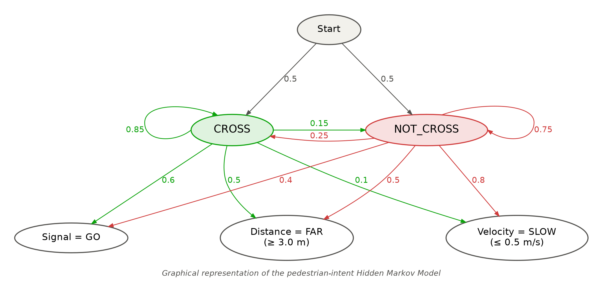
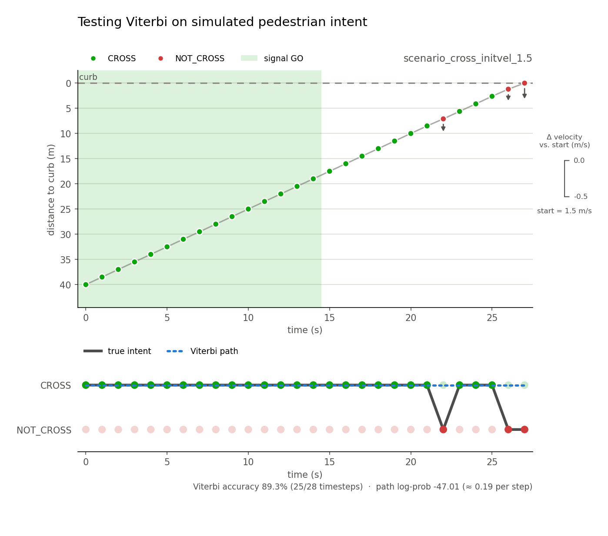
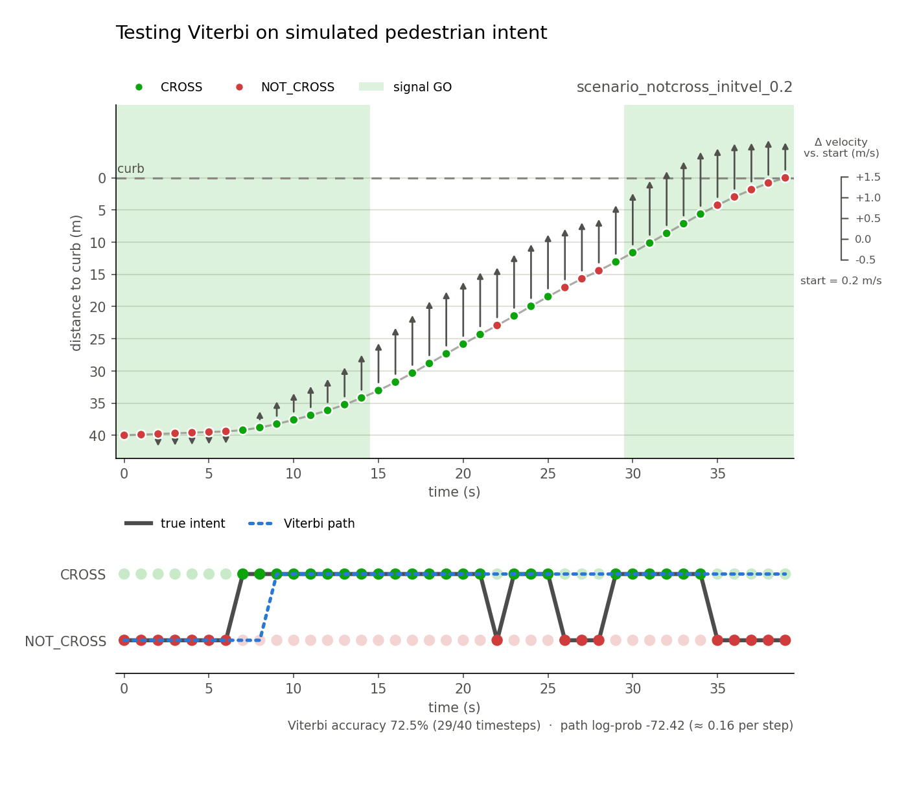

# Predict Pedestrian Intent at Crosswalks using the Viterbi Algorithm

> Vivian Mak \
> Data Structure and Algorithm Course

How can we tell whether a pedestrian walking towards a crosswalk intends to cross using a subset of observations?

This project models that question as a **hidden Markov model (HMM)** and solves it with the **Viterbi algorithm**. A dynamic-programming approach is used to find the highest probable sequence of hidden states with knowledge of current and previous sequence of observations.

- **Hidden state (what we want to know):** the pedestrian's intent at each timestep, `CROSS` or `NOT_CROSS`
- **Observations (what we can measure):** the walk signal (GO / STOP), distance to the curb (m) and velocity (m/s)

Intent is modeled across frames or timesteps as a combination of the **transition probabilities**, defining the likelihood of state transition, and the **emission probabilities**, defining the contribution of observations to the hidden state.Through these two set of modeled probabilties, **a single best intent path is derived**.

Intent tends to persist from one second to the next (the **transition probabilities**), and each intent makes some observations more likely than others (the **emission probabilities**; for example, a crossing pedestrian tends to walk briskly while the signal says GO). Viterbi combines the two to find the single best intent path.

In this project, I have abstracted the world to two states `CROSS` or `NOT_CROSS` and simplified the observations that contribute to this model. A simulator was used to generate toy problems with options to adjust parameters. The generated trajectory has an "answer key" which is the true intent. The Viterbi only reads from the list of observations and returns the most likely path and the logged probability of the path. Finally, a comparison is made against the true intent to produce an accuracy score.

A simulator generates pedestrian trajectories from a known intent, so every scenario has an answer key. Viterbi sees only the observations and returns its predicted intent at each timestep and the log probability of that path. Comparing it against the true intent gives an accuracy score.

Deliverables:

- Generate python visualizations of observations vs intent
- Scenario toy problems by hard coding a set of probabilities of high likelihood of crossing / not crossing
- Implement Viterbi algorithm to infer most likely sequence of intent states from simulated observation
- Github repo w/ readme, documentation, design decisions


My workflow:

1. Generate simulation and log scenario
2. Run on Viterbi
3. Compare intent paths
4. Plot visualization
5. Adjust parameters

## Defining a Statistical Model

File: [pedestiran-intent/include/params.hpp](include/params.hpp)

- Probabilities are stored as plain values (each row sums to 1)
    - easy to read and check, and the simulation samples directly from them
- Viterbi converts them to log probabilities https://en.wikipedia.org/wiki/Log_probability
    - Viterbi multiplies one probability per timestep along a path, so the product underflows (rounds to 0) on long sequences
    - log turns multiplying into adding: log(a * b) = log(a) + log(b), and a sum of logs doesn't shrink to 0

### Transition Probabilities

| Prev States | CROSS | NOT_CROSS |
| :---: | :---: | :---: |
| CROSS| 0.85 | 0.15 |
| NOT_CROSS | 0.25 | 0.75 |

Wtih a previously derived `CROSS` state:
- The likelihood of transitioning to `CROSS` is high
- The likelihood of transitioning to `NOT_CROSS` is low

Wtih a previously derived `NOT_CROSS` state:
- The likelihood of transitioning to `CROSS` is low
- The likelihood of transitioning to `NOT_CROSS` is high

### Emission Probabilities

| States | SIGNAL | DISTANCE | VELOCITY |
| :---: | :---: | :---: | :---: |
| CROSS| 0.6 | 0.5 | 0.1 |
| NOT_CROSS | 0.4 | 0.5 | 0.8 |


For a `CROSS` state,

- The signal has the highest contribution, because pedestrians will often only cross when `SIGNAL = True`
- The distance partially contributes, because there is a non-zero chance a pedestrian will cross even if they are approaching
- The velocity is the second highest contributor, because a pedestrian increasing in velocity is assumed to try to cross

For a `NOT_CROSS` state,
- The signal has a low contribution to account for pedestrians that cross anyway
- The distance to the curb and velocity will be the most important to determine whether a pedestrian intents to `NOT_CROSS` by slowing down or vice versa

The probabilities here don't sum up to 1 because each observation has multiple "substates". For example, the binary signal has GO or STOP states, the distance is defined by CLOSE or NOT CLOSE through `constexpr double FAR_DIST`.



## Simulating Observations

File: [include/simulation.cpp](include/simulation.cpp)

Set a simulation goal of recovering `CROSS` or `NOT_CROSS`

### Simulating Pedestrian Signal

Defined by a bool of the following states:
- `GO` - (`True`)
- `STOP` - (`False`) 

Transitions every x seconds.


### Simulating Velocity

I brainstormed several approaches to simulaiting the velocity, and decided to go with approach 2.

Approach 1: Gaussian distribution, independent samples
- drawing random samples from the distribution
- but this lacks correlation to previous time step
- clamps speed to min/max

Approach 2: Gaussian noise, w/ random vel spikes
- update the previous speed with some gaussian noise
- add a random occasional increase/decrease in speed to simulate running/slowing down
- set intial speed to some random vel (m/s) capping max and min

Approach 3: Subcategories within velocity
- creaate velocity states: slow-walking, walking, running
- define tri-model distribution
- randomness to jump btwn means

### Simulating Distance

We simply use the equation `dist = dist + (velocity * dt)`. The distance is controlled by the velocity.

### Logging Simulations

The simulations are logged in [data/scenarios.json](data/scenarios.json) using the `nlohmann_json` library. The data fields logged include:
- name of scenario
- description (optional)
- intent
- simulation params
- observation list
- true states
- predicted intent (filled in after from viterbi)
- accuracy

## Viterbi Algorithm

File: [src/viterbi.cpp](src/viterbi.cpp)

1. Use dynamic programming to build matrix of size 2 x N_observations
2. Initialize the first timestep's probability to 50/50 to capture unknown
3. For each timestep,
4. For each possible hidden state,
5. Find the probability of a transition from past timestep's state `prob_t = prob_t-1[state] + log(tranition_probability)`
6. Find the best path from t-1 timestep with highest probability
7. Compute a probability of hidden state based on observations
8. Calculate the probability of current state based on observations `prob_t-1[state] = prob_best_path + log(emission probability)`
9. Fill in a table with backpointers
10. Find highest probability at final timestep
11. Backtrack to find optimal path


## Testing

When generating the simulation, the true intent is also encoded in the sim's metadata, but never directly read from viterbi until the final accuracy comparison.

I performed a test below to peforme a parameter sweep of the `initial velocity` from `0.2 to 1.5` keeping the other parameters consistent.

```cpp
SimModel::SimulationParams params{
        .name            = "scenario_cross",
        .intent          = HMM_Params::States::CROSS, // AND NOT_CROSS
        .dt              = 1,   // don't change
        .total_time      = 40,
        .signal_duration = 15,
        .init_vel        = // param sweep
        .curb_distance   = 40,
        .seed            = 0,
    };
```


For intial `CROSS` intent:

| Init_vel | True Final Intent | Predicted Final Intent | Path Accuracy (%) | Path Probability (log) | 
| :---: | :---: | :---: | :---: | :---: |
| 0.2| CROSS | CROSS | 76.5 | -60.35 |
| 0.4 | CROSS | CROSS | 84.8 | -56.93
| 0.6| CROSS | CROSS | 87.1 | -52.24 |
| 0.8 | CROSS | CROSS | 86.7 | -50.77 |
| 1.0| NOT_CROSS | CROSS | 86.2 | -48.89 | 
| 1.2 | NOT_CROSS | CROSS | 86.2 | -48.89 |
| 1.5 | NOT_CROSS | CROSS | 89.3 | -47.01 | 
| 2.0 | NOT_CROSS | CROSS | 89.3 | -47.01 |

For intial `NOT_CROSS` intent:


| Init_vel | True Final Intent | Predicted Final Intent | Path Accuracy (%) | Path Probability (log) | 
| :---: | :---: | :---: | :---: | :---: |
| 0.2| NOT_CROSS | CROSS | 72.5 | -72.42 |
| 0.4 | NOT_CROSS | CROSS | 70.7 | -78.83 |
| 0.6| NOT_CROSS | CROSS | 67.5 | -72.86 |
| 0.8 | NOT_CROSS | CROSS | 68.4 | -69.26 |
| 1.0| NOT_CROSS | CROSS | 69.4 | -64.37 | 
| 1.2 | CROSS | CROSS | 67.6 | -56.65 |
| 1.5 | CROSS | CROSS | 64.5 | -52.24 | 
| 2.0 | CROSS | CROSS | 64.5 | -52.24 |

<br>

I plotted scenarios with the highest accuracies below. ([AI Disclosure](#ai-disclosure)) The top plot visualizes the scenario via distance to the curb over time. The bottom plot visualizes the comparison of the path of true intent (generated from sim) and the derived intent path with the viterbi algorithm.

This scenario had an intial intent of `CROSS` and intial velocity of `1.5`.



This scenario had an intial intent of `NOT_CROSS` and intial velocity of `0.2`.



<br>

## Results

- The maximum accuracy for intial states: `CROSS = 89.3%` and `NOT_CROSS = 72.5%`. The lowest accuracy for intial states: `CROSS = 76.5%` and `NOT_CROSS = 64.5%`. The model performs better when the intial state starts as cross.
- The `predicted final intent` of inital `NOT_CROSS` state always resulted in cross. There could be some flaw with the model that biasses towards crossing. This could also be interpreted as a saftey of factor.
- All of the log probabilities are very low signalling that the scenario is unlikely. However, the average probability is higher for an intial state of `CROSS`. Again, this could be because the model biases towards crossing


## Next Steps
- Refine the observation models (ie how long until the signal countdowns to 0, incorporate other objects like approaching vehicles)
- A bigger emission table to account for the substates of observation categories (ie. Velocity = {slow, walking, running})
- Fine tune the model to reduce the log probabilities

## Resources
- https://medium.com/@satyamsettiveerapraveen/viterbi-algorithm-62b0434f831d
- https://en.wikipedia.org/wiki/Viterbi_algorithm
- https://www.geeksforgeeks.org/artificial-intelligence/viterbi-algorithm-for-hidden-markov-models-hmms/

## AI Disclosure
The following files were written with AI:
- [src/scenario_io.cpp](src/scenario_io.cpp) - Writing to and reading from json files
- [data/plot_scenarios.py](data/plot_scenarios.py) - Generate plots from json file